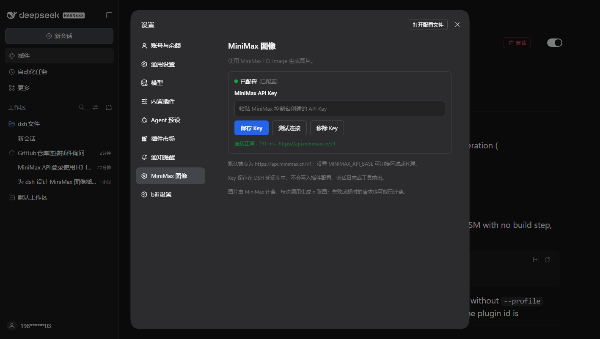
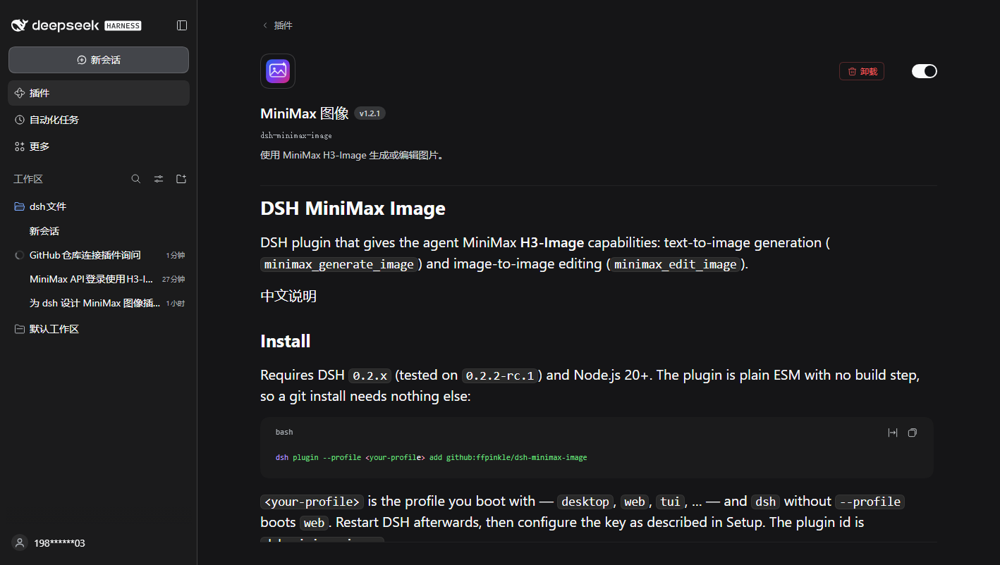

# DSH MiniMax Image

DSH plugin that gives the agent MiniMax **H3-Image** capabilities: text-to-image generation
(`minimax_generate_image`) and image-to-image editing (`minimax_edit_image`).

[中文说明](#中文说明)

**Quick start**: install the plugin → paste a MiniMax API key in **Settings → MiniMax Image** →
say “draw an orange cat wearing a hat, watercolor”.

## 中文快速上手

1. **安装**：在 DSH 里打开 **设置 → 插件 → 发现**，搜索 `dsh-minimax-image` 安装，然后重启 DSH。
   （暂时搜不到就用命令行装，见 [Install](#install)。）
2. **拿 Key**：去 [platform.minimaxi.com](https://platform.minimaxi.com/)（国内站）或
   [platform.minimax.io](https://platform.minimax.io/)（国际站）注册、充值、在控制台创建 API Key。
3. **配置**：**设置 → MiniMax 图像** → 选与 Key 同区域的端点 → 粘贴 Key → **保存 Key**。
   保存后会自动测试连接（只请求免费的模型列表接口，不出图、不扣费）。
4. **出图**：新会话里说「画一只戴帽子的橘猫，水彩风格」。

## Screenshots

| Settings: pick the region, paste the key, test the connection | Plugin page: what DSH shows once installed |
| --- | --- |
|  |  |

## Install

Requires DSH `0.2.x` (tested on `0.2.2-rc.1`) and Node.js 20+. The plugin is plain ESM with no
build step, so every method below installs the same files.

### In DSH (recommended)

Open **Settings → Plugins → Discover**, search for `dsh-minimax-image`, install it, then restart
DSH. The plugin id is `dsh-minimax-image`.

If the market index does not list it yet, use one of the command-line methods below. Restart DSH
afterwards, then configure the key as described in [Setup](#setup).

The command-line methods take `<your-profile>`, the profile you boot with — `desktop`, `web`,
`tui`, … — and `dsh` without `--profile` boots `web`.

### npm

```bash
dsh plugin --profile <your-profile> add dsh-minimax-image
```

Published from `1.3.0`. Pin a version with `dsh-minimax-image@1.3.1`.

### GitHub

Nothing to build: the repository ships `index.js` and `client.js` ready to load.

```bash
dsh plugin --profile <your-profile> add github:ffpinkle/dsh-minimax-image
```

This follows `main`, so every push changes what the next install gets. Pin a tag for a fixed
version:

```bash
dsh plugin --profile <your-profile> add github:ffpinkle/dsh-minimax-image#v1.3.1
```

### Local clone

Clone the repository and link the checkout — edits to `index.js` and `client.js` then take effect
after a DSH restart, with no reinstall:

```bash
git clone https://github.com/ffpinkle/dsh-minimax-image
dsh plugin --profile <your-profile> add link:D:/path/to/dsh-minimax-image
```

### Which one

| Method | Use it when | Updating |
| --- | --- | --- |
| In DSH | you use the desktop or web UI | install the new version from **Discover** |
| npm | you want versioned releases and no git | bump the version in the `add` command |
| GitHub | you want `main` or a pinned tag | `dsh plugin add` the new ref |
| Local clone | you are changing the plugin | restart DSH after each edit |

## Get an API key

Image calls go to your own MiniMax account, so you need your own key:

1. Open the console for your region — [platform.minimaxi.com](https://platform.minimaxi.com/)
   (China) or [platform.minimax.io](https://platform.minimax.io/) (international) — and sign up.
2. Add credit. A key with a zero balance fails with HTTP 402; the account also needs access to
   `MiniMax-H3-Image` (and `MiniMax-H3-Image-Highspeed` for the fast model).
3. Create an API key on that console's API-keys page and copy it.

Keys are region-bound: a key created on `platform.minimaxi.com` only works with
`https://api.minimax.cn/v1`, and one from `platform.minimax.io` only with
`https://api.minimax.io/v1`. Pick the matching **API endpoint** in the settings page before
saving the key.

## Requirements

- A MiniMax API key whose account can call `MiniMax-H3-Image` / `MiniMax-H3-Image-Highspeed`
  and has a positive balance. Image calls are billed per generated image.
- The key must belong to the same region as the endpoint. Pick the region in **Settings → MiniMax
  Image → API endpoint** (see [Setup](#setup)): `Mainland China (api.minimax.cn)` for keys from
  `platform.minimaxi.com`, `International (api.minimax.io)` for `platform.minimax.io`. For a proxy,
  choose `Custom URL`. Before the setting exists the default is `https://api.minimax.cn/v1`, and
  `MINIMAX_API_BASE` still works as an environment fallback. An international key against the China
  endpoint (or the reverse) fails with HTTP 401.

## Setup

1. Open **Settings → MiniMax Image / MiniMax 图像**.
2. Open [Get an API key](#get-an-api-key) and copy a key for the region you are in.
3. Pick the **API endpoint** that matches the region of your key — **Mainland China (.cn)**,
   **International (.io)**, or **Custom URL** for a proxy. The choice is saved to
   `<DSH home>/plugin-data/dsh-minimax-image/settings.json` and survives restarts; the next tool
   call and connection test use it immediately, no restart needed. If `MINIMAX_API_BASE` is set in
   the environment, the saved choice here wins and the page says so.
4. Paste the API key and choose **Save key / 保存 Key**.
   The key is stored in the DSH credential store as `MINIMAX_API_KEY`; it is never written to
   plugin config, session logs, or tool output. The plugin immediately runs the free connection
   test described below and reports the result next to the button.
5. Choose **Test connection / 测试连接** any time to check the key without generating anything. The
   test calls only the free model-list endpoint (`GET /v1/models`) behind the same gateway, so it
   proves the key is accepted for the configured endpoint and never bills an image. HTTP 401
   means the key is invalid, revoked, or belongs to another region.
6. If the settings page cannot manage credentials in your client, set `MINIMAX_API_KEY` in the
   environment instead.

## Examples

Once a key is saved, ask in plain language — the agent calls the tool for you:

- “画一只戴帽子的橘猫，水彩风格” / “Draw an orange cat wearing a hat, watercolor.”
- “把这张图改成夜景，保留人物” / “Turn this image into a night scene, keep the person.”
- “生成 4 张 1:1 的极简头像” / “Generate four 1:1 minimalist avatars.”

## Tools

### `minimax_generate_image` (text to image)

| Parameter | Default | Notes |
| --- | --- | --- |
| `prompt` | required | Up to 32000 characters |
| `size` | — | Exact output size as `WxH` pixels (e.g. `1024x1536`); overrides `aspect_ratio` and `area`. 655,360–20,000,000 px total, ratio within 1:3–3:1 |
| `n` | 1 | 1–10; each image is billed |
| `aspect_ratio` | `1:1` | `auto` or `X:Y`, 1:3–3:1 |
| `area` | `2K` | `1K`, `2K`, or `4K` |
| `output_format` | `jpeg` | `jpeg`, `png`, or `webp` |
| `output_compression` | 95 | 0–100 for jpeg/webp |
| `prompt_enhance` | true | `false` requires an explicit aspect ratio |
| `aigc_watermark` | false | Explicit watermark; implicit AIGC metadata is always written |
| `highspeed` | false | Uses `MiniMax-H3-Image-Highspeed` |

### `minimax_edit_image` (image to image)

| Parameter | Default | Notes |
| --- | --- | --- |
| `prompt` | required | What to change; editing always applies MiniMax prompt enhancement |
| `images` | required | 1–16 references, in order: local file path, `http(s)` URL, `data:image/...` URI, or a `sha256:<hex>` attachment id |
| `size` | — | Exact output size as `WxH` pixels; overrides `aspect_ratio` and `area` |
| `n` | 1 | 1–10; each image is billed |
| `aspect_ratio` | `auto` | `auto` or `X:Y`, 1:3–3:1 |
| `area` | `2K` | `1K`, `2K`, or `4K` |
| `output_format` | `jpeg` | `jpeg`, `png`, or `webp` |
| `output_compression` | 95 | 0–100 for jpeg/webp |
| `aigc_watermark` | false | Explicit watermark |
| `highspeed` | false | Uses `MiniMax-H3-Image-Highspeed` |

Reference limits (enforced by MiniMax): JPG/JPEG/PNG/WEBP/HEIC/HEIF, at most 64 MiB per file,
128–8192 px per side, aspect ratio up to 4:1, 1–16 images, and 64 MiB for the whole request body
(local files are inline base64, so they grow by about 4/3). Local paths are read by the plugin,
checked for size, format, and pixel dimensions before upload (so an oversized or too-small
reference fails locally instead of burning a round trip), and uploaded inline; public URLs are
passed through untouched.

#### Using an image from the chat

Attach the image to your message and ask for the change in plain language — the agent passes the
attachment's `sha256:<hex>` id to `minimax_edit_image`, which the plugin resolves to the stored
image and uploads. Nothing is copied or re-uploaded by hand.

If the agent asks for a path instead (for example in a client that does not expose attachment
ids), save that image to disk and give the agent its absolute path
(for example `D:\pictures\cat.png`); local paths are read and validated by the plugin before
upload.

The model does not support mask-based local editing, transparent backgrounds, or preview images.

Both tools save results through the DSH attachment service and return them as image content plus
a text summary. Partial failures are reported per image; a request still succeeds when at least
one image was produced.

## Billing and retries

MiniMax bills per generated image. The endpoints are **not idempotent**: after a timeout or a
network error the server may still finish and bill the request. The plugin never retries
automatically. Do not retry blindly; check the MiniMax console first.

The default `area` is `2K` for both tools, which costs more than `1K`; pass `area: "1K"` when you
want the cheapest output.

Rough 2026-11 pricing on the international site (per 1M tokens): text input $2.30, image input
$1.50, output $3.80 — about $0.022 for one 1K image.

## Troubleshooting

| Symptom | Meaning |
| --- | --- |
| HTTP 401 | Bad key, or key and endpoint are in different regions |
| HTTP 402, code 1008 | Account balance is zero — top up or claim credit in the console |
| HTTP 2022 | The account has no access to the model/plan |
| HTTP 1027 / 1026 | Output / input blocked by content safety; rephrase the prompt or image |
| `aspect_ratio must be explicit when prompt_enhance is false` | Pass a concrete ratio, or re-enable enhancement |
| Green “Configured” but generation fails | The green dot means a key is stored, not that it works — press **Test connection** to verify it |

## 中文说明

这是一个 DSH 插件，把 MiniMax **H3-Image** 接到 agent 上，提供两个工具：

- `minimax_generate_image`：文生图；
- `minimax_edit_image`：图生图（图片编辑）。

**安装**：插件 id 为 `dsh-minimax-image`，需要 DSH 0.2.x（已测 `0.2.2-rc.1`）和 Node 20+。

1. 推荐：在 DSH 里打开 **设置 → 插件 → 发现**，搜索 `dsh-minimax-image` 安装，然后重启 DSH。
2. 市场暂时搜不到时，用命令行（装完都要重启 DSH）：
   - npm（1.3.0 起）：`dsh plugin --profile <你的 profile> add dsh-minimax-image`
   - GitHub：`dsh plugin --profile <你的 profile> add github:ffpinkle/dsh-minimax-image`
     （想固定版本就加 `#v1.3.1` 这样的 tag）
   - 本地克隆：`dsh plugin --profile <你的 profile> add link:D:/path/to/dsh-minimax-image`，
     改完代码重启 DSH 即生效，不用重装。

**拿 Key**：到 [platform.minimaxi.com](https://platform.minimaxi.com/)（国内站）或
[platform.minimax.io](https://platform.minimax.io/)（国际站）注册 → 充值 → 在控制台创建 API Key。
Key 与区域绑定：国内站的 Key 只能配 `api.minimax.cn`，国际站的只能配 `api.minimax.io`。

**配置**：设置 → 「MiniMax 图像」→ 先选 **API 端点**（国内 / 国际 / 自定义代理 URL）→ 粘贴 Key →
保存。保存后会自动跑一次免费的连接测试并报告结果。端点选择存在
`<DSH 主目录>/plugin-data/dsh-minimax-image/settings.json`，重启保留、下次调用立即生效。
Key 存在 DSH 凭证库（`MINIMAX_API_KEY`），不会写入配置、日志或工具输出。环境变量
`MINIMAX_API_BASE` 仍可作为兜底，但设置页里保存的选择优先。

**测试连接**：只请求免费的模型列表接口（`GET /v1/models`），不会出图、不产生费用，用来确认 Key
与端点区域匹配。返回 401 说明 Key 无效、已撤销或属于另一个区域。

**第一句话**：配置好后直接说「画一只戴帽子的橘猫，水彩风格」或「生成 4 张 1:1 的极简头像」。

**图生图用法**：给 `images` 传 1–16 张参考图，可以是本地文件路径（插件自动读文件、校验大小与格式、
转 base64 上传）、公网 URL、`data:image/...` 形式的 data URI，或对话里贴图对应的 `sha256:<hex>`
附件 id。在对话里贴图后直接说「把这张图改成夜景」即可，插件会把附件换成参考图；如果 agent 要路径，
先把图片存到磁盘再把绝对路径给它。编辑固定会开启 MiniMax 的提示词增强，
返回的 `revised_prompt` 通常比你写的更详细。参考图限制：JPG/PNG/WEBP/HEIC/HEIF、单张 ≤64MB、
边长 128–8192px、长宽比不超过 4:1、整个请求体 ≤64MB。

**计费**：按张计费，接口非幂等——超时或断连后请求可能仍会完成并扣费，插件不会自动重试，不要盲目重复调用。
两个工具的默认 `area` 都是 `2K`，比 `1K` 贵；要最省就显式传 `area: "1K"`。

## Local development (maintainer)

The plugin is a normal DSH bundle. From this directory:

```
plugin_manager install_bundle  target: <path to this directory>
```

The bundle patch is `cordis.patch.yml`. During development the package is linked into the
profile's `node_modules` as a junction instead of being copied, so edits to `index.js` take
effect after restarting DSH and no reinstall is needed. The link is what makes the plugin card
show `@local` / 本地开发 in the plugin manager.

If you keep a checkout next to your profile, link it with:

```bash
dsh plugin --profile <your-profile> add link:D:/path/to/dsh-minimax-image
```

Tests run on plain `node:test` with no dependencies and no network:

```bash
npm run check   # node --check on both entry points + i18n parity + the whole test suite
npm test        # unit, stubbed-API and credential-route tests
```

`tests/api.test.js` stubs `fetch`, so it asserts the request body and that a failed
generation is never retried. A live, billed generation is opt-in:

```bash
MINIMAX_API_KEY=sk-... node scripts/smoke.mjs   # one 1K image, ~¥0.1, never retried
```
